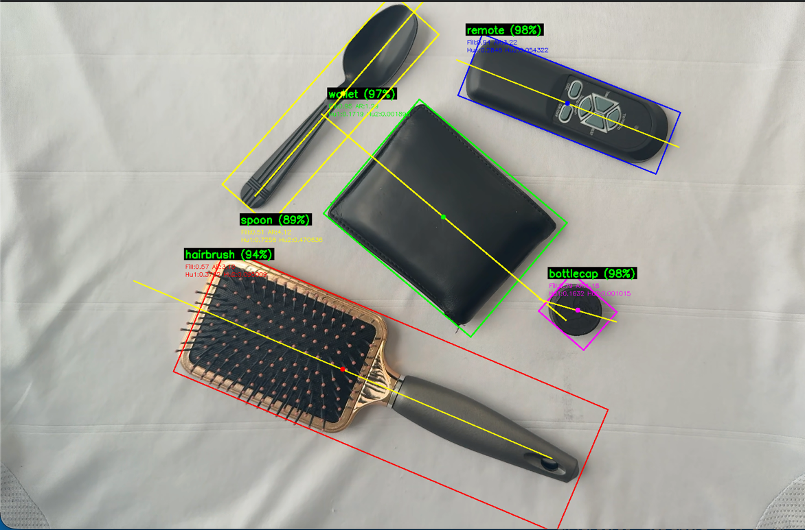
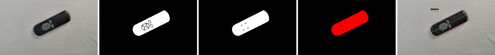
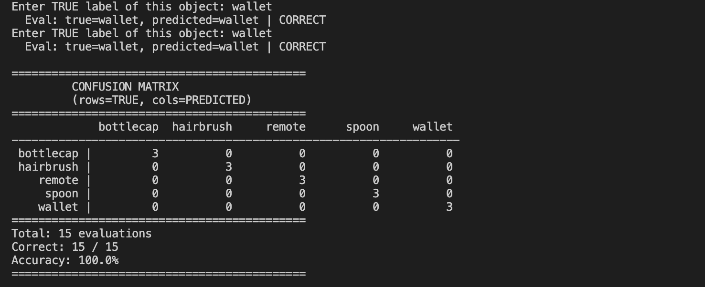

# Real-time 2D Object Recognition

A C++/OpenCV system that recognizes objects on a flat surface from a live webcam feed, regardless of their position, scale or rotation. It segments every object in the frame, computes shape features and classifies each object with one of two methods: a nearest-neighbor classifier on hand-crafted features, or a one-shot classifier on ResNet18 embeddings. You can train new objects and evaluate them while the program runs.



## How it works

1. **Thresholding:** Gaussian blur, HSV conversion, then an adaptive threshold from 2-cluster k-means on a subsampled set of pixels. This separates dark objects from the light background.
2. **Morphological filtering:** a 7×7 closing fills holes inside objects, then a 5×5 opening removes background noise.
3. **Connected components:** a two-pass labeling algorithm written from scratch with a Union-Find structure. Regions smaller than 500 px or touching the image border are discarded.
4. **Features:** for each region, the principal axis comes from second-order central moments. From it the system computes the oriented bounding box, percent filled, aspect ratio and Hu moments 1–2. All of these are invariant to translation, scale and rotation.
5. **Classification:**
   - *Hand-crafted:* scaled Euclidean nearest neighbor over the 4-D feature vector, with an "unknown" threshold.
   - *CNN embedding:* the region is placed on a white background, rotated to align its principal axis, cropped to its bounding box and resized to 224×224. A pretrained ResNet18 (ONNX, run with OpenCV DNN) then produces a 512-D embedding, which is matched to the closest stored embedding by sum-squared difference.

Each region is classified independently, so several objects can be recognized in the same frame. Recognized labels are drawn in green with a confidence score, and unknown objects in red.



## Results

Both classifiers reached 100% accuracy on 15 test images covering 5 objects (bottle cap, hairbrush, remote, spoon, wallet), each shown in different positions and orientations. The CNN embeddings held up better than the hand-crafted features when orientation and lighting changed.



## Requirements

- C++17 compiler (clang++)
- OpenCV 4 with the `dnn` module, discoverable through `pkg-config opencv4` (e.g. `brew install opencv pkg-config`)
- A webcam

## Build

```bash
cd src
make model   # downloads the pretrained ResNet18 ONNX model into data/
make         # builds bin/objectRecognition
```

## Usage

Run the program from the `src/` directory, because the model path and the training databases are relative to it:

```bash
cd src
../bin/objectRecognition
```

Put objects on a plain, light background under the camera.

| Key       | Action                                                        |
| --------- | ------------------------------------------------------------- |
| `n`       | Train: store hand-crafted features for an object (prompts for a label) |
| `e`       | Evaluate the current object with the hand-crafted classifier  |
| `c`       | Print the confusion matrix for the hand-crafted classifier    |
| `N`       | Train: store a CNN embedding for an object                    |
| `E`       | Evaluate the current object with the CNN classifier           |
| `C`       | Print the confusion matrix for the CNN classifier             |
| `q` / Esc | Quit                                                          |

If more than one region is visible during training, you are asked which one to label. Training data is appended to `objects.csv` and `embedding_db.csv`, so it carries over between runs.

> **Camera note:** this was developed with an iPhone used as a webcam (Continuity Camera). The frame is flipped horizontally in `objectRecognition.cpp`, and the embedding crop orientation in `utilities.cpp` is adjusted for that setup. If your labels or crops look mirrored, remove the `cv::flip` call.

## Project structure

```
src/        pipeline, classifiers, training/evaluation, makefile
include/    headers
data/       pretrained ResNet18 model (downloaded with `make model`)
docs/       figures
```

## Author

Furqan Abid
